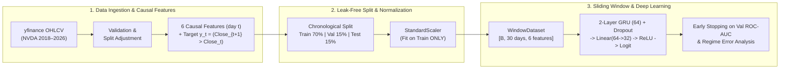
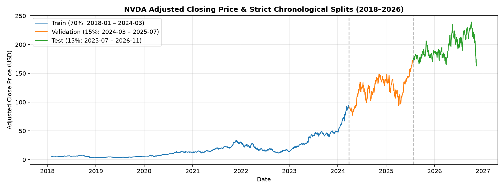
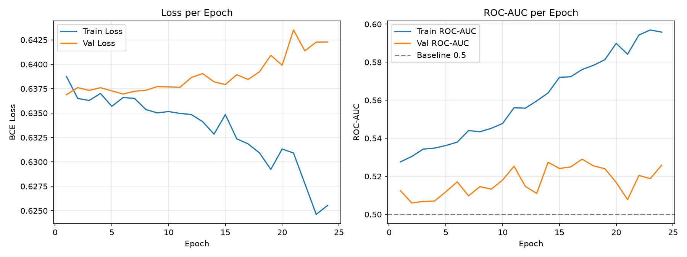
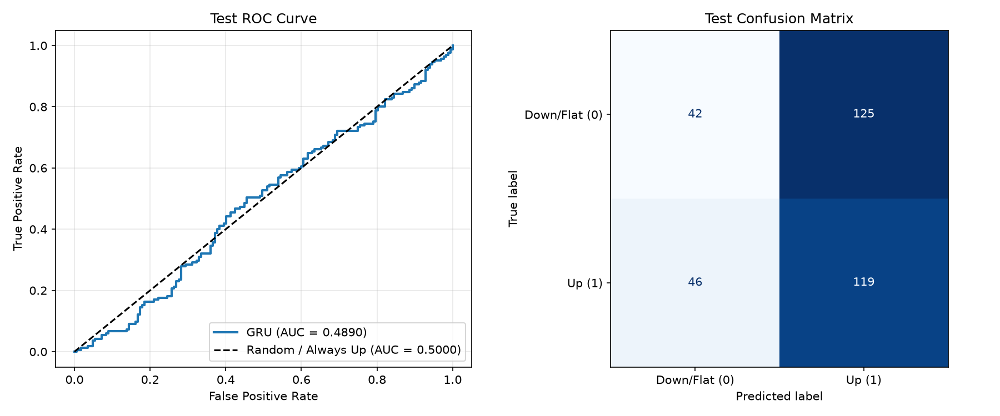

# fin-nn: Production-Grade Time-Series Deep Learning for Equity Direction Forecasting

[](https://www.python.org/downloads/)
[](https://pytorch.org/)
[](https://github.com/astral-sh/uv)
[](https://github.com/astral-sh/ruff)
[](#testing--quality-assurance)

**`fin-nn`** is an end-to-end, leak-free deep learning pipeline built with **PyTorch** that forecasts the next-day closing price direction of **NVIDIA (`NVDA`)** using a 30-day lookback window of technical and volatility indicators.

Unlike typical retail stock-prediction tutorials that report inflated metrics due to look-ahead bias, global normalization, or random train/test splits, `fin-nn` is engineered around **quantitative research best practices**: strict causal feature engineering, automated look-ahead leakage testing, chronological regime splitting, and rigorous baseline benchmarking.

---

## Business Problem & Real-World Value

### 1. Eliminating Look-Ahead Bias in Quantitative R&D
In quantitative finance and algorithmic trading research, **90%+ of promising backtests fail in production** because of subtle data leaks—fitting scalers on the entire dataset, shuffling time-series windows, or misaligning target shifts.
- **What `fin-nn` solves:** Provides a deterministic, unit-tested blueprint where causal isolation is mathematically enforced. Modifying future prices at day $t + k$ is programmatically verified to have **zero effect** on features at day $t$.

### 2. Decision Support & Risk-Regime Filtering
Rather than attempting to predict exact dollar prices (which are non-stationary and prone to spurious regression), directional probability models ($P(\text{Close}_{t+1} > \text{Close}_t)$) serve as modular components in institutional workflows:
- **Execution & Timing Signals:** Assisting execution desks in deciding whether to accelerate or delay scheduled orders over a 24-hour horizon.
- **Volatility-Aware Confidence Gating:** Identifying high-volatility market regimes where directional predictability degrades, allowing risk managers to scale down exposure or widen stops.
- **Model Governance Benchmark:** Demonstrating when a complex sequential neural network (`GRU`) adds value over simpler linear baselines (`Logistic Regression`) and naive trend followers (`Always Up`), and diagnosing when market regime shifts invalidate learned patterns.

---

## System Architecture & Data Flow



---

## Dataset & Chronological Regime Split

The dataset spans **2,231 trading days** of daily split-adjusted `NVDA` OHLCV data (`2018-01-02` to `2026-11-16`), including seamless handling of the 10-for-1 stock split in June 2024. After removing the 20-day rolling indicator warm-up period and the final unlabelled day, **2,210 clean observations** are partitioned strictly by time:



| Split | Date Range | Clean Rows | 30-Day Windows | Bullish Days (`y = 1`) | Market Regime Characteristics |
| :--- | :--- | :---: | :---: | :---: | :--- |
| **Train (70%)** | `2018-01-31` → `2024-03-25` | 1,547 | 1,518 | **53.98%** | Crypto/GPU cycles, 2022 bear market, early AI boom |
| **Validation (15%)** | `2024-03-26` → `2025-07-22` | 331 | 331 | **54.38%** | Post-split momentum & strong secular uptrend |
| **Test (15%)** | `2025-07-23` → `2026-11-13` | 332 | 332 | **49.70%** | Consolidation & mean-reverting sideways regime |

> **Boundary Window Rule:** A 30-day window targeting the first day of `Validation` or `Test` is permitted to use the trailing 29 days from the preceding split as historical input context ($X$), while its target ($y_t$) strictly belongs to the evaluated split.

---

## Feature Engineering (Strictly Causal)

All features for day $t$ are computed using information available at or before the closing bell of day $t$:

| Feature | Formula | Financial Interpretation |
| :--- | :--- | :--- |
| `log_ret` | $\ln(\text{Close}_t / \text{Close}_{t-1})$ | Daily logarithmic return (stationary momentum) |
| `hl_range` | $(\text{High}_t - \text{Low}_t) / \text{Close}_t$ | Normalized intraday trading range / bar volatility |
| `vol_chg` | $\ln(\text{Volume}_t / \text{Volume}_{t-1})$ | Relative surge or contraction in market participation |
| `rsi14` | $\text{RSI}(\text{Close}, 14)$ | 14-day Relative Strength Index (overbought/oversold oscillator) |
| `price_sma20` | $\text{Close}_t / \text{SMA}_{20}(\text{Close})_t$ | Price extension relative to the 20-day moving average |
| `vol20` | $\text{Std}_{20}(\text{log\_ret})_t$ | 20-day realized return volatility |

---

## Model Architecture: `GRUClassifier`

Designed to remain compact and regularized to combat overfitting on ~1,500 daily training windows:

| Component | Configuration | Output Shape |
| :--- | :--- | :--- |
| **Input Window** | 30 trading days $\times$ 6 scaled features | `[B, 30, 6]` |
| **Recurrent Backbone** | 2-Layer `nn.GRU` (`hidden_size=64`, inter-layer `dropout=0.2`) | `[B, 30, 64]` |
| **Temporal Pooling** | Final step top-layer hidden state $h_T^{(-1)}$ | `[B, 64]` |
| **Classification Head** | `Linear(64 -> 32)` $\rightarrow$ `ReLU` $\rightarrow$ `Dropout(0.2)` $\rightarrow$ `Linear(32 -> 1)` | `[B]` (raw logit) |

- **Loss Function:** `BCEWithLogitsLoss` with dynamic `pos_weight = N_neg / N_pos` computed strictly on `Train` to prevent majority-class collapse.
- **Optimizer & Scheduler:** `AdamW` (`lr=1e-3`, `weight_decay=1e-4`), gradient norm clipping (`1.0`), `ReduceLROnPlateau` (`mode="max"`, `factor=0.5`, `patience=3` on Validation ROC-AUC).
- **Early Stopping:** Monitors **Validation ROC-AUC** (`patience=7`) to select threshold-independent ranking quality.

---

## Experimental Results & Visual Analysis

### 1. Benchmark Comparison (`Validation` vs. `Test`)

Every model is evaluated against two domain baselines:
1. **Always Up Baseline:** Always predicts class `1` (reflecting NVDA's strong historical upward drift of ~54% during 2018–2025).
2. **Logistic Regression (Last Day):** Uses only the 6 features of day $t$ without sequential history, testing whether the 30-day temporal context adds value.

| Model | Val Accuracy | Val F1 | Val ROC-AUC | Test Accuracy | Test F1 | Test ROC-AUC |
| :--- | :---: | :---: | :---: | :---: | :---: | :---: |
| **Always Up Baseline** | **0.5438** | **0.7045** | 0.5000 | 0.4970 | **0.6640** | 0.5000 |
| **Logistic Regression (Last Day)** | 0.5136 | 0.6462 | 0.5055 | **0.5000** | 0.6612 | **0.5400** |
| **GRUClassifier (Best Epoch 17)** | 0.5227 | 0.4936 | **0.5290** | 0.4849 | 0.5819 | 0.4890 |

### 2. Training Dynamics & Test Performance Plots





### 3. Regime & Volatility Error Analysis on Test

Breaking down `GRUClassifier` test performance across calendar years and realized volatility regimes (`vol20` split at the median):

| Regime Slice | Sample Size ($n$) | Actual Up Ratio | Accuracy | F1 Score | ROC-AUC |
| :--- | :---: | :---: | :---: | :---: | :---: |
| **Year 2025** (`2025-07` – `2025-12`) | 113 | 50.4% | 0.4867 | 0.5915 | 0.4762 |
| **Year 2026** (`2026-01` – `2026-11`) | 219 | 49.3% | 0.4840 | 0.5768 | 0.4971 |
| **Low-Volatility Regime** (`vol20 <= median`) | 166 | 48.8% | **0.5120** | **0.6161** | **0.4922** |
| **High-Volatility Regime** (`vol20 > median`) | 166 | 50.6% | 0.4578 | 0.5455 | 0.4807 |

### Key Quantitative Takeaways
1. **Why Accuracy Alone Is Misleading:** On `Validation`, `Always Up` achieves `54.38%` accuracy simply because NVDA rose on 54.38% of days—yet its ranking power (`ROC-AUC`) is pure chance (`0.5000`). Using `pos_weight` and selecting checkpoints by `ROC-AUC` prevents the neural network from degenerating into a trivial constant predictor.
2. **Validation Gain vs. Out-of-Sample Regime Shift:** On `Validation`, `GRUClassifier` outperforms both baselines in ranking quality (`Val ROC-AUC = 0.5290` vs. `0.5055` for Logistic Regression). However, in the `Test` period (`2025-07` to `2026-11`), NVDA transitioned from a 54% bullish trend to a 49.7% sideways regime. In this regime shift, the simpler 6-parameter `Logistic Regression` generalized better (`Test ROC-AUC = 0.5400`) than the 30-day recurrent network (`0.4890`).
3. **Volatility Degradation:** The GRU's accuracy is **+5.42 percentage points higher** in low-volatility regimes (`51.20%`, `F1 = 0.6161`) than in high-volatility regimes (`45.78%`, `F1 = 0.5455`), confirming that high-volatility shocks are largely driven by exogenous news rather than endogenous price history.

---

## Repository Structure

```text
fin-nn/
├── assets/                 # Visual charts embedded in documentation
│   ├── nvda_splits.png
│   ├── training_curves.png
│   └── test_evaluation.png
├── configs/
│   └── config.yaml         # Single source of truth: ticker, dates, window, model & training hyperparameters
├── data/                   # Cached raw & processed CSVs (git-ignored)
├── notebooks/
│   └── eda.ipynb           # Exploratory Data Analysis notebook
├── runs/                   # Checkpoints (best_model.pt), JSON metrics, CSV logs, TensorBoard (git-ignored)
├── src/
│   ├── data.py             # Yahoo Finance ingestion, split/spike validation, local CSV cache
│   ├── features.py         # Causal indicators, target alignment, leakage test, 70/15/15 split & StandardScaler
│   ├── dataset.py          # Sliding WindowDataset (PyTorch Dataset) & reproducible DataLoaders
│   ├── model.py            # GRUClassifier architecture
│   ├── train.py            # Baselines, 1-batch overfit sanity check, training loop, early stopping, TensorBoard
│   ├── evaluate.py         # Out-of-sample evaluation, ROC/CM charts, year & volatility error analysis
│   └── utils.py            # Deterministic seeding, hardware device discovery, YAML loader
├── tests/
│   └── test_pipeline.py    # Automated pytest suite for future leakage, scaler isolation & tensor shapes
├── pyproject.toml          # Project dependencies & tool configurations (uv, pytest, ruff)
├── uv.lock                 # Reproducible lockfile
└── README.md
```

---

## Quickstart & Reproducibility

### Prerequisites
- **Python 3.12+** and **[`uv`](https://docs.astral.sh/uv/)** installed.

### 1. Clone & Install Dependencies
```bash
git clone https://github.com/Bauer1/fin-nn.git
cd fin-nn
uv sync
```

### 2. Run the Pipeline Step-by-Step
All modules are executed from the project root via `uv run python -m src.<module>`:

```bash
# Step 1: Download & validate NVDA history (cached in data/raw/)
uv run python -m src.data

# Step 2: Engineer features, run causal leakage verification, and split/scale data
uv run python -m src.features

# Step 3: Verify sliding-window tensors and boundary alignment
uv run python -m src.dataset

# Step 4: Evaluate baselines, pass the single-batch overfit sanity check, and train GRUClassifier
uv run python -m src.train

# Step 5: Evaluate best checkpoint on Test, generate plots, and print regime breakdown
uv run python -m src.evaluate
```

### 3. Inspect Training Logs in TensorBoard
```bash
uv run tensorboard --logdir runs/tb
```

---

## Testing & Quality Assurance

The repository includes an automated test suite verifying the most critical failure modes in financial ML:
- `test_no_future_leakage`: Perturbs future OHLCV values at $t+1$ and $t+5$ and asserts zero change in features at day $t$.
- `test_split_and_scaler_isolation`: Asserts zero mean and unit variance strictly on `Train` without contaminating `Val` or `Test`.
- `test_window_dataset_alignment`: Verifies exact slice alignment between `WindowDataset` tensors and the underlying feature table across split boundaries.
- `test_gru_classifier_forward`: Verifies model forward pass dimensions.

```bash
# Run unit tests
uv run pytest

# Run linter and code formatter check
uv run ruff check . && uv run ruff format --check .
```
